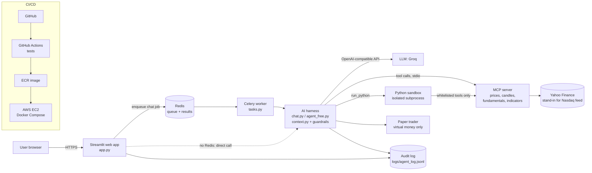

# Financial Harness: AI Stock Market Assistant

An AI portfolio manager that brings market data, company research and analysis into one conversational interface.
A "harness" coordinates the model, its context, its permissions and its tools. The model never touches money and
never sees raw API keys: it can only read data and propose; the harness validates, paper-tests and records everything.

> **Demo only. Not financial advice.** All trades are virtual. No real orders can be placed (enforced in code and tested).

---

## 1. Product view

**Problem.** Retail investors juggle charting sites, filings and spreadsheets, and generic chatbots invent numbers.
**Solution.** One interface where every number comes from a tool (with a source and timestamp), every calculation runs in a
sandbox, and every suggestion is paper-tested against guardrails before it is shown.

| User need                                         | Feature                                                                             | Where                       |
| ------------------------------------------------- | ----------------------------------------------------------------------------------- | --------------------------- |
| "How is my portfolio doing against my goal?"      | Portfolio, goal progress, required yearly return                                    | Dashboard sections 1-2      |
| "What is the market doing?"                       | Candlestick chart, volume, 20/50-day averages, RSI, MACD                            | Section 3, `get_indicators` |
| "What should I consider?"                         | Long-term and short-term suggestions, paper-tested, blocked ones shown with reasons | Section 4                   |
| "Is this goal realistic? What if TSLA drops 30%?" | Chat: Python-computed projections and what-ifs                                      | Section 5, sandbox          |
| "Can I trust this?"                               | Sources and timestamps, audit log, guardrails                                       | Everywhere                  |

**Success measures (proposed).** Share of answers with a source line; share of numeric claims produced by tools or sandbox
(not by the model); suggestions blocked by guardrails (shows the guardrails work); median time to answer; cost per answer.

**Out of scope (for now).** Real trading, personalised financial advice, licensed real-time exchange feeds, multi-user accounts.

### Requirement traceability

| Requirement                                              | Status        | Notes                                                                                                                                |
| -------------------------------------------------------- | ------------- | ------------------------------------------------------------------------------------------------------------------------------------ |
| Technical analysis (candles, indicators, trends, volume) | Done          | Plotly chart, SMA20/50, RSI, MACD                                                                                                    |
| Fundamental analysis                                     | Partial       | Valuation ratios, margins, growth via `get_fundamentals`. Full statements and earnings history not yet (add a `get_financials` tool) |
| Python calculations, comparisons, projections, what-ifs  | Done          | `run_python` sandbox, chat tables                                                                                                    |
| Explanations, charts, tables, sources, assumptions       | Mostly        | Charts are in the dashboard; chat answers are text and tables with a sources line                                                    |
| AI harness (model, context, permissions, workflow)       | Done          | `harness/agent_free.py`, `chat.py`, `context.py`, `guardrails.py`                                                                    |
| MCP integrations                                         | Done          | `harness/mcp_server/server.py` (prices, candles, fundamentals, indicators)                                                           |
| Tool calling and programmatic tool calling (PTC)         | Done          | Direct mode and PTC mode                                                                                                             |
| Python sandbox                                           | MVP           | Subprocess with import allow-list, timeout, no secrets. See "Security"                                                               |
| Background processing                                    | Done for chat | Celery + Redis, progress, retries, saved results. Suggestion generation is not queued yet                                            |
| Cloud deployment, CI/CD                                  | See section 6 | Docker, GitHub Actions, AWS                                                                                                          |

---

## 2. Architecture



**Data flow for a chat question.** (1) The web app sends the trimmed history to a Celery task. (2) The worker starts the
harness, which starts the MCP server and gives the model a list of allowed tools. (3) The model calls tools; the harness runs
them, shortens large outputs (context management) and records each call. (4) For maths, the model writes Python; the
sandbox runs it and can only call whitelisted read-only tools. (5) The answer goes back through Redis; the web app shows
progress while it waits.

**Data flow for suggestions.** Model submits structured suggestions, then the harness validates the schema and data
freshness, then the paper trader sizes a virtual order, runs risk and stress checks, and approves or blocks it.

### Guardrails (see `docs/GUARDRAILS.md`)

1. Every BUY needs a stop-loss; risk per trade is capped (2%) and one position is capped (30%).
2. Real orders are impossible: no order tool exists, and the paper account refuses any non-paper mode.
3. Stress test (a repeat of the worst 5-day drop in 6 months must cost at most 5% of the portfolio) and data must be under 15 minutes old.

### Context management (`harness/context.py`)

- Only the latest chat turns are sent (`trim_history`).
- Raw candles are summarised before the model sees them (`compact_candles`).
- When a run grows past a token budget, older tool outputs are shortened but never removed, so tool-call pairs stay valid (`compress_messages`).
- Identical repeated tool calls are answered from a cache.

---

## 3. Folder structure

```
financial-harness/
├── app.py                    Streamlit dashboard + chat UI (entry point)
├── celery_app.py             Celery app (broker/result backend = Redis)
├── tasks.py                  Background tasks (chat) with progress and retries
├── requirements.txt
├── Dockerfile  docker-compose.yml  .dockerignore  .env.example
├── .github/workflows/ci-cd.yml
├── harness/                  Core package
│   ├── agent_free.py         Suggestion agent (direct + PTC modes), OpenAI-compatible LLM
│   ├── agent.py              Tool definitions and prompts (+ Anthropic variant)
│   ├── chat.py               Conversational agent
│   ├── context.py            Context management
│   ├── guardrails.py  paper_trader.py  schemas.py
│   ├── harness_common.py     Paths, MCP client, tool whitelist, audit log
│   ├── dashboard_data.py     Data layer used by the UI and by Celery tasks
│   ├── sandbox.py  sandbox_runner.py
│   └── mcp_server/server.py  MCP server (market data tools)
├── data/portfolio.json       Demo portfolio and goals
├── logs/                     Audit log and saved chat results (git-ignored)
├── scripts/                  Demos: run_paper_demo.py, run_ptc_demo.py, ptc_analysis.py
├── tests/                    test_guardrails, test_offline, test_context, test_dashboard, test_client, test_chat
└── docs/                     GUARDRAILS.md
```

---

## 4. Run locally

```powershell
python -m venv .venv
.\.venv\Scripts\Activate.ps1
pip install -r requirements.txt
$env:GROQ_API_KEY = "gsk_..."          # free key from console.groq.com. Never commit it.
streamlit run app.py
```

Tick **Use synthetic data** to work offline. Without a key, use the **Rule-based sample** engine.

**With the background queue** (three terminals, venv active in each):

```powershell
docker run -d -p 6379:6379 redis:7                                   # 1. Redis
$env:REDIS_URL="redis://localhost:6379/0"; $env:GROQ_API_KEY="gsk_..."
celery -A celery_app worker --loglevel=info --pool=solo               # 2. worker (Windows)
$env:REDIS_URL="redis://localhost:6379/0"; $env:GROQ_API_KEY="gsk_..."
streamlit run app.py                                                  # 3. web
```

Or everything at once: `docker compose up --build` (needs a `.env` with `GROQ_API_KEY`; see `.env.example`).

CLI demos: `python -m harness.agent_free --provider groq --goal "10 Years" --mode ptc`, `python -m scripts.run_paper_demo --fake`.

---

## 5. Test

Run from the project root.

| Layer                               | Command                           | Needs internet / key      |
| ----------------------------------- | --------------------------------- | ------------------------- |
| Guardrails and paper trader         | `python -m tests.test_guardrails` | No                        |
| Sandbox, PTC, agent loop (fake LLM) | `python -m tests.test_offline`    | No                        |
| Context management                  | `python -m tests.test_context`    | No                        |
| Dashboard (headless browser test)   | `python -m tests.test_dashboard`  | No                        |
| MCP server tools                    | `python -m tests.test_client`     | Internet                  |
| Chat agent end to end               | `python -m tests.test_chat`       | Internet + `GROQ_API_KEY` |
| Queue end to end                    | see below                         | Redis + worker + key      |

**Queue test.** With Redis and the worker running, start Streamlit with `REDIS_URL` set, ask a question, and check: the progress
bar moves, the worker log shows `Task fh.chat[...] succeeded`, `logs/chat_results.jsonl` gains a line, and stopping Redis makes
the app fall back to a direct run with a warning.

**Manual acceptance checklist.**

- [ ] "I want $20,000 in 2 years. Is that realistic?" gives a Python-computed required return and shows the `run_python` code under **Tools used**.
- [ ] "Compare AAPL and TSLA on valuation and profitability" gives a table and a sources line (live data only).
- [ ] "What if TSLA drops 30%?" uses the sandbox.
- [ ] "Should I buy more TSLA?" explains evidence and trade-offs and does not give an order.
- [ ] A suggestion that breaks a guardrail appears under **Blocked by guardrails** with the reason.
- [ ] Every answer ends with sources and assumptions.

---

## 6. Deploy (GitHub Actions, ECR, EC2)

1. Push to GitHub. The workflow runs the offline tests on every push and pull request.
2. On `main`, it builds the Docker image, pushes it to Amazon ECR, then SSHes into the EC2 instance and runs `docker compose pull && up -d`.
3. Secrets live in GitHub Secrets (`AWS_ACCESS_KEY_ID`, `AWS_SECRET_ACCESS_KEY`, `EC2_HOST`, `EC2_SSH_KEY`) and in `~/app/.env` on the server (`GROQ_API_KEY`, `APP_PASSWORD`, `FH_MAX_AI_RUNS`). Never in the repo.
4. Open ports 22 (your IP only) and 8501. Keep `APP_PASSWORD` set on any public link.
5. The web and worker containers share `./logs` as a volume so the audit log shows worker events.

---

## 7. Security and known limits

- **Sandbox is an MVP.** It uses a separate process, an import allow-list, blocked builtins, a timeout, no API keys in its environment, and a tool whitelist. It is not a hardened boundary. For production, run each execution in a locked-down container or microVM (for example an ECS Fargate task or a hosted sandbox service) with no network.
- **Market data is Yahoo Finance via yfinance** (free, about 15 minutes delayed), a stand-in for a licensed Nasdaq feed. Only `harness/mcp_server/server.py` talks to the data source, so swapping providers is a change in one file.
- **LLM free tier** limits tokens per minute; the harness waits and retries, and context management keeps requests small.
- **Run cap** (`FH_MAX_AI_RUNS`) is per process and resets on restart.
- Models can still make mistakes. The harness reduces this (tool-only numbers, sandbox maths, guardrails) but does not eliminate it.

## 8. Roadmap

`get_financials` (statements, earnings), charts inside chat answers, queueing for suggestion generation, per-user portfolios and authentication, hardened sandbox, licensed market data.
